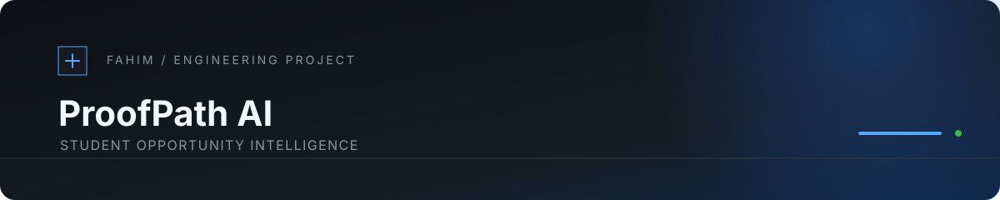

<div align="center">




[Social preview SVG source · 1280 × 640](./assets/brand/social-preview.svg)

</div>

# ProofPath AI 3.0 — Student Opportunity Intelligence, Verification & Trust Operations Platform

**Live demo:** [Open ProofPath AI on Render](https://proofpath-ai-demo.onrender.com)

> **Demo limitations:** Hosted on a free service without a persistent disk, so SQLite data may reset after a restart or redeployment. Gemini-powered verification and chat require a configured `GEMINI_API_KEY`.

ProofPath AI 2.0 is a full-stack TypeScript web application built to help students discover scholarships, fellowships, internships, grants, and competitions while verifying claims against primary sources, computing deterministic eligibility intelligence, and managing applications end-to-end.

## Architecture Overview

- **Frontend**: React 19, TypeScript, Tailwind CSS v4 (Warm Ivory / Deep Ink / Electric Lime editorial palette with Light & Dark modes), Lucide icons, client-side PDF export (`jspdf`).
- **Backend**: Express + TypeScript (`server.ts`, `server/app.ts`) with Zod validation, HTTP-only cookie sessions, scrypt password hashing, CSRF protection, sliding-window rate limiting, SSRF network guardrails (`server/ssrf.ts`), and magic-byte file upload validation (`multer`).
- **Database**: Persistent SQLite via `better-sqlite3` (`WAL` mode, foreign keys enforced, idempotent schema migrations in `server/db.ts`).
- **AI Engine**: Server-side `@google/genai` (`gemini-4-hydrogen`) with Google Search grounding, URL Context inspection, multimodal PDF/image/screenshot analysis, bilingual (English & Bangla) context-aware advising, and AI usage telemetry logging (`server/ai.ts`).

## ProofPath AI 2.0 Core Modules

1. **Opportunity Intelligence Score (0–100)**: Transparent weighted scoring across Profile Completeness (30), Verified Match Coverage (30), Application Readiness (25), and Verification Hygiene (15), paired with a Personal Opportunity Radar, Deadline Intelligence (Urgent / Upcoming / Expired), and Personal Action Center.
2. **Evidence Relationship Explorer & Audit History Comparison**: Interactive node-link graph tracing `Submission → Extracted Organization → Claim Nodes → Retrieved Evidence Sources → Verdict`, chronological Audit Timeline, and side-by-side comparison across saved verification reports.
3. **Opportunity Match Intelligence & Trust Profiles**: Personalized funding fit, academic compatibility, deadline urgency, missing-attribute checks, official domain classification, linked verification counts, and community report totals on every opportunity detail page.
4. **Application Intelligence**: Kanban, List, and interactive Monthly Calendar views with real-time Readiness Checklists highlighting missing documents and incomplete steps.

## Database Setup & Models

SQLite persists to `DB_PATH` (defaults to `./data/proofpath.db`). Migrations run automatically on startup across the core account, application, verification, and trust-monitoring tables:
- `users`, `sessions`, `password_resets`, `student_profiles`
- `opportunities`, `verification_reports`, `evidence_records`, `saved_opportunities`
- `applications`, `application_documents`, `notifications`, `notification_preferences`
- `conversations`, `messages`, `community_reports`, `moderation_logs`
- `admin_audit_logs`, `ai_usage_logs`, `contact_messages`, `site_content`

### Development Evaluation Accounts

Seeded only when `NODE_ENV !== 'production'` and explicitly blocked from signing in when `NODE_ENV === 'production'`:
- **Student**: `student@proofpath.ai` / `Student@2026!`
- **Moderator**: `moderator@proofpath.ai` / `Moderator@2026!`
- **Admin**: `admin@proofpath.ai` / `Admin@2026!`

In production deployments, register standard accounts via `/register` or provision administrators directly on the database.

## Environment Variables

Copy `.env.example` to `.env` and configure:
- `GEMINI_API_KEY`: Server-side Gemini API key (required for live verification & AI advisor).
- `APP_URL`: Public URL of the deployed service.
- `SESSION_SECRET`: Random high-entropy string for HMAC session token hashing.
- `DB_PATH`: Path to persistent SQLite file (e.g., `./data/proofpath.db`).

## Local Development, Testing & Deployment

```bash
npm install
npm run dev      # Starts Express + Vite middleware on port 3000
npm run lint     # TypeScript typecheck
npm test         # Runs Vitest integration & security suite
npm run build    # Builds Vite production bundle to dist/
npm start        # Serves production API + static dist/ via tsx server.ts
```


## Model Context Protocol (MCP) integration

ProofPath AI includes a standalone, read-only MCP server in `mcp-server/`. It exposes five tools over the MCP **stdio** transport and consumes only the application's existing public HTTP GET routes. It does not create a second database connection, bypass the Express API, access student profiles, expose verification-report contents, or perform writes.

### MCP server inventory

| MCP tool | Existing ProofPath API route | Purpose |
|---|---|---|
| `search_opportunities` | `GET /api/opportunities` | Search and filter published opportunities |
| `get_opportunity_details` | `GET /api/opportunities/:id` | Read a public opportunity and trust summary |
| `compare_opportunities` | `GET /api/opportunities/compare` | Compare up to four published opportunities |
| `get_public_platform_stats` | `GET /api/public/stats` | Read aggregate public platform counts |
| `check_api_health` | `GET /api/health` | Check API/database health without returning configuration secrets |

The opportunity-detail tool deliberately returns an allowlisted public projection and a verification-history count; it does not expose raw verification reports, claims, uploaded-file metadata, or user identifiers. All five tools are read-only.

### Run locally

Node.js 22 or later is required.

```bash
cd mcp-server
npm install
npm test
npm start
```

By default, the server targets the public demo at `https://proofpath-ai-demo.onrender.com`. To use a local ProofPath instance, set `PROOFPATH_API_BASE_URL=http://127.0.0.1:3000` before starting it.

The repository-root `.mcp.json` contains a project-level stdio server entry for compatible MCP hosts. Install the standalone package dependencies first, then open the repository in an MCP-compatible client.

### Protocol verification and scope

The automated integration test starts a real MCP stdio server process and connects to it with the official MCP TypeScript SDK client. It checks initialization, tool discovery, tool execution, GET-only API access, and redaction of private verification-history content. The server currently supports **stdio only**; Streamable HTTP, legacy SSE, and WebSocket transports are not claimed. The server is currently specific to ProofPath AI and has not yet been reused by another project.

## Security Controls

- **Authentication**: `crypto.scryptSync` salted password hashing + `crypto.timingSafeEqual` verification, HTTP-only `SameSite=Lax` cookies, and per-session `X-CSRF-Token` validation on state-changing requests. Demo evaluation accounts are disabled in production (`NODE_ENV === 'production'`).
- **SSRF Protection**: Rejects `localhost`, loopback, link-local, cloud metadata (`169.254.169.254`), and private IPv4/IPv6 CIDR ranges before fetching external URLs.
- **Upload Validation**: 10 MB limit, MIME allowlist (`PDF`, `PNG`, `JPEG`, `WEBP`), and binary magic-byte header verification.
- **Role-Based Access Control**: Server-side `requireRole('admin', 'moderator')` enforcement on all administrative and moderation endpoints with persistent `admin_audit_logs`.


## ProofPath AI 3.0 — Trust Intelligence

The 3.0 trust layer adds the following capabilities:

- **Evidence source signals:** Each retrieved evidence URL receives a deterministic URL-level score based on HTTPS and alignment with the opportunity's listed host. The score is not a domain reputation check and never proves ownership, accreditation, or legitimacy.
- **Opportunity change history:** A scheduled checker stores a text snapshot of public opportunity pages and records content-hash changes. A changed page is a review signal; the system does not infer that a deadline or funding term changed without a human checking the page.
- **Saved opportunity watchlists:** Students can configure in-app deadline reminders and page-change notifications for opportunities they have saved.
- **Community safety patterns:** Administrators and moderators can review report volume, distinct reporters, reason diversity, and moderation state by host. These metrics prioritize review and do not establish fraud.
- **Explainable eligibility:** The API returns criterion-level rules, missing profile fields, completeness, and next steps. Missing information is not scored as a pass.
- **Trust & Safety analytics:** A role-protected operational view summarizes published listings, monitored changes, reports, saved listings, and evidence links.
- **Verification comparison:** Authenticated users can compare 2–4 reports they are authorized to view, including repeated claim text and conflicting verdicts.
- **Bilingual advisor:** The assistant has stricter English/Bengali consistency, evidence attribution, uncertainty, and untrusted-page-text rules.

### Scheduled monitoring setup

The workflow in `.github/workflows/opportunity-monitor.yml` is a GitHub Actions scheduler that runs every six hours and can also be started manually. It calls the authenticated internal endpoint on the Render service.

1. Generate a random secret with at least 32 characters.
2. Add it in GitHub: **Repository → Settings → Secrets and variables → Actions → New repository secret**, named `MONITORING_CRON_SECRET`.
3. Add the same value in Render: **proofpath-ai-demo → Environment**, also named `MONITORING_CRON_SECRET`.
4. Deploy the branch after review and merge, then use **Actions → Opportunity monitoring → Run workflow** to test it.

The endpoint rejects requests when the secret is missing or invalid. The workflow does not print the secret to its logs.

### Deployment and persistence limitations

The connected Render service is currently on the Free plan and uses the application's SQLite file under `./data`. A free service without a persistent disk can lose local database contents during restarts or redeployments. The monitoring code and scheduler do not remove that platform limitation. For dependable long-term watchlists and change history, configure persistent storage or migrate the application's primary database before treating scheduled history as durable.

In-app notifications are supported. Outbound email and push delivery are not enabled in this release; no email address is contacted by the monitor. GitHub Actions requires the repository secret above, and the Render service requires the matching environment variable. No paid Render resources are provisioned by this change.
